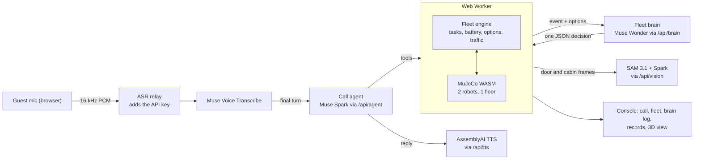

# Muse Concierge

A hotel guest phones room service. A Muse Spark agent takes the order and quotes an ETA. A Muse Wonder "fleet brain" decides which of two delivery robots takes the job. When a robot's battery fails on the way, the brain re-plans the delivery. At the door, SAM 3.1 and Muse Spark check the room number and the cabin. The robots are simulated in MuJoCo in the browser.

Built for the **Meta Global AI Developer Hackathon** (indie track, Push the Frontier).

**What came from earlier work:** this project builds on the author's earlier [Concierge](https://github.com/johnnytan5/Concierge) project, an AssemblyAI voice agent for a hotel robot. The hotel floor, the cabinet robot design, the operations dashboard layout and the Supabase tables for inventory, calls and escalations come from that project and were adapted here. The Meta model integration, the fleet brain, the camera checks and the collection flow were built for this hackathon. The commit history in this repository is the record.

## What the demo shows

1. **Clean start.** Both robots are docked and the task queue is empty. **Reset demo** returns to this state at any time.
2. **A guest calls.** "Two towels and my Uber Eats order, please." The call comes from a known room, so the agent doesn't ask for it. Muse Voice Transcribe hears the request, and the Spark agent creates one task for one cabin and gives an ETA.
3. **The agent checks for anything else.** It asks before ending the call. Anything a robot can't bring, such as a late checkout, goes to the front desk as an escalation.
4. **The brain assigns a robot.** Muse Wonder gets the new-order event and picks one of the options the engine computed. Staff load the cabin and press **Bin loaded**.
5. **A battery fault hits mid-delivery**, dropping the robot to 9%. The engine works out every option with its ETA: carry on (not feasible), charge first, or hand off to the other robot.
6. **The brain hands the order over.** A plan card shows every option with its ETA, the one Wonder picked and why, and what follows from it. The faulted robot goes home to charge, and the other robot loads the order and delivers.
7. **The guest's view.** On arrival the stage switches to what the guest sees as the door opens, then to the robot's cabin camera.
8. **The robot checks the door and the cabin.** SAM 3.1 boxes the door and the room number plate, and Muse Spark reads the number. SAM 3.1 then finds each item in the cabin.
9. **The guest collects.** **Mimic collection** stands in for the guest, because there is no one in the simulator. The robot photographs its cabin again, and the task completes only when SAM 3.1 finds it empty, twice. A failed model call never counts as empty. If nobody collects within 2 minutes, the robot goes home and the task is marked *not collected*.

The console shows all of it live: the call and a "What happened" flow, fleet status and battery, deliveries, the brain log, room notices, past calls, escalations, inventory and the stock ledger.

## Meta models and what each one does

| Job | Model | Notes |
|---|---|---|
| Hearing the guest | **Muse Voice Transcribe** (`muse-voice-transcribe-1.0`) | Streaming, endpointing, keyword biasing on room numbers and item names |
| Talking to the guest, calling tools | **Muse Spark** (`muse-spark-1.1`) | `create_task`, `get_task_status`, `cancel_task`, `escalate_to_frontdesk`, `end_call`. One agent per call |
| Running the fleet | **Muse Wonder** (`muse-wonder-1.0`) | Called only on events. Picks one engine-computed option and answers in JSON |
| Seeing | **SAM 3.1** (`sam-3.1`) + **Muse Spark** | At the door, SAM boxes the door and the number plate and Spark reads the number. In the cabin, SAM finds each item before collection and confirms the cabin is empty after it |

These parts are not Meta models:
- **Speech output:** AssemblyAI text-to-speech through a server route, with the browser's own voice as a fallback. Muse Voice Transcribe is speech-to-text only.
- **Physics:** MuJoCo.
- **Backup transcriber:** AssemblyAI, used only if the Muse relay can't be reached.

### Measured, not assumed

Each choice below came from a script in `scripts/`. You can re-run any of them.

**Transcription** (`scripts/asr-bench.mts`): 10 hotel requests in five English accents, streamed in real time.

| Provider | Room numbers right | Median delay after speech ends |
|---|---|---|
| Muse Voice Transcribe, phrase keywords | 9/10 | 538 ms |
| AssemblyAI Universal-Streaming | 10/10 | 1648 ms |

Biasing on whole phrases ("room 804") instead of bare numbers took Muse from 7/10 to 9/10, because it stops hearing "room eight…" as "roommate". The call already knows its room, and `create_task` rejects rooms that don't exist.

**Call agent** (`scripts/agent-ablation.mts`). Spark always reasons before answering; no setting turns that off. So the script compares model version, effort level and a "decide fast" prompt nudge on the four turns of a call:

| Setting | Median latency per turn |
|---|---|
| Spark 1.3 | 1.7–1.8 s |
| **Spark 1.1, minimal effort + nudge** (shipped) | **about 0.9 s** |

Every setting got every turn right, so speed decided.

**Brain** (`scripts/brain-check.mts`): at minimal effort, Wonder chose correctly every time, in 1.7–7 s.

## How it fits together



- **The physics never shares a thread with the voice call.** MuJoCo and the task engine run in a Web Worker, and the page talks to them through `FleetClient`.
- **Tools return immediately.** `create_task` queues the order and returns an ETA. Arrival comes back later as an event, never as a tool result.
- **The brain chooses, it never invents.** The engine offers the options with ETAs it computed. `parseDecision` accepts only an offered option, and the engine checks again before applying it. If the reply is slow, malformed or stale, the fastest feasible option is applied instead, and the log marks it *fallback*.
- **People never read model-written text in the console.** The brain log lines and room notices are built from the brain's JSON.
- **The call survives a dropped transcriber.** Muse can close a session mid-call ("Audio processing backlog too large"), so the page reconnects by itself, up to 3 times per call.
- **Housekeeping tasks** still exist in the engine and its tests (a guest order can pause one), but the app no longer starts one.

## Running it

You need Node 24 and Chrome.

```bash
npm install
cp .env.example .env          # fill in your own keys, see below
npm run relay                 # terminal 1: Muse Voice Transcribe relay on ws://localhost:8787
npm run dev                   # terminal 2: http://localhost:3000
```

**Demo mode:** set `NEXT_PUBLIC_DEMO_MODE=1` or open **http://localhost:3000/?demo=1** to have the battery fault fire automatically on the first delivery. Without it, use the **Battery fault** button.

### Environment variables

Put these in `.env`, which git ignores. **API keys are never committed**, so use your own. `.env.example` is the template.

| Variable | Required | What it is | Where it comes from |
|---|---|---|---|
| `META_API_KEY` | Yes | All Meta model calls and the relay. Server-side only | Meta Model API console |
| `SUPABASE_URL` | Yes | Inventory and call records | Supabase project settings |
| `SUPABASE_SERVICE_ROLE_KEY` | Yes | Database access. Server-side only, never in a `NEXT_PUBLIC_` variable | Supabase project settings |
| `ASSEMBLYAI_API_KEY` | For the agent's voice | Text-to-speech and the backup transcriber. Without it, the browser voice is used | AssemblyAI dashboard |
| `NEXT_PUBLIC_ASR_RELAY_URL` | Hosted only | The relay's address. Defaults to `ws://localhost:8787` | Your relay, `wss://…` when hosted |
| `ASR_RELAY_ORIGINS` | Hosted only | Pages allowed to use the relay, comma-separated | Your site's origin |
| `CRON_SECRET` | Hosted only | Protects the daily keep-alive route | Any long random value, set in Vercel |
| `TTS_VOICE` | No | AssemblyAI voice id. Defaults to `aai-sara` | AssemblyAI voice list |
| `NEXT_PUBLIC_CALL_LIMIT_ENABLED` | No | `false` turns off the daily call limit on the hosted site. On by default. Rebuild after changing | |
| `NEXT_PUBLIC_CALLS_PER_IP_PER_DAY` | No | Calls per IP per day when the limit is on. Defaults to 3. Rebuild after changing | |
| `NEXT_PUBLIC_DEMO_MODE` | No | `1` fires the battery fault automatically | |
| `NEXT_PUBLIC_ASR_PROVIDER` | No | `assemblyai` forces the backup transcriber | |
| `SPARK_MODEL`, `BRAIN_MODEL`, `SAM_MODEL` | No | Model overrides | |

### Database

The app shares its Supabase project with Concierge:

1. Apply the migrations in [Concierge's `supabase/migrations`](https://github.com/johnnytan5/Concierge/tree/main/supabase/migrations). They create the inventory, call and escalation tables.
2. Apply `supabase/migrations/20261030120000_muse_fleet_state.sql` for saved runs and the per-IP call limit.

### Why a relay

Muse Voice Transcribe takes the API key inside the WebSocket and has no short-lived browser token. `scripts/asr-relay.mjs` adds the key on the server. It only accepts the origins in `ASR_RELAY_ORIGINS` and caps each session at 5 minutes. For a hosted deployment, run it behind a TLS proxy or tunnel.

## Checks

```bash
npm test                                    # unit tests: tools, call session, engine, options, brain, notices, metrics, camera checks
node scripts/nav-check.mts                  # route clearance around walls and corners
node scripts/sim-check.mts                  # a battery-fault scenario on real MuJoCo physics, headless
node scripts/call-check.mts                 # a scripted call through /api/agent (dev server running)
node --env-file=.env scripts/brain-check.mts
node scripts/relay-check.mjs [relay-url]    # stream a bench clip through the ASR relay, print what Muse heard
npm run e2e                                 # the whole demo with real models: a recorded call through Chrome's fake mic to a completed collection and a reset
```

## Limits and what is not here

- **Robots:** two simulated robots on one floor, driven by a waypoint graph with pure pursuit. There is no SLAM and no lift.
- **Rooms:** 803, 804, 1204 and 1205 sit on one modelled floor.
- **Languages:** Muse Voice Transcribe supports 25 validated languages, but this demo is set up and tested in English.
- **Robot cameras:** SAM 3.1 found nothing in the flat-shaded overview, even for "door". So the cameras render a second layer of the same floor with textured walls, carpet, wooden doors and brass number plates (`components/doorstep.ts`), plus modelled items in the cabin (`components/items.ts`). The robots in those frames are the MuJoCo robots. Real camera frames would replace this layer on hardware.
- **Collection is simulated:** the button and the animation stand in for a guest. SAM's checks on the frames before and after are real. Prompts were tuned on these rendered frames (the food bag is "green bag"), and items without a model skip the cabin check.
- **The food bag is generic:** an Uber Eats order rides in an unbranded delivery bag.
- **Spend limits:** the hosted demo allows 3 calls per IP per day by default (see `NEXT_PUBLIC_CALLS_PER_IP_PER_DAY`).

## Repository layout

```
app/                 console page and API routes (agent, brain, vision, TTS, call, records, stock, cron)
components/          call panel, 3D view and cameras, robot cards, task queue, brain log, records tabs
lib/admin/           call log, escalation and stock helpers, the flow graph
lib/agent/           call-agent tools, prompt, session
lib/brain/           brain prompt, decision parsing and fallback, log lines, page-side client
lib/fleet/           engine, options and ETAs, navigation, notices, metrics
lib/meta/            Meta Model API client
lib/sim/             MuJoCo SimPort, Web Worker, client, message types
lib/vision/          SAM box parsing, the door and cabin verdicts
lib/voice/           mic capture, Muse and AssemblyAI adapters, echo gate, speech
public/sim/floor.xml the hotel floor and both robots (MJCF)
scripts/             benches, checks, ASR relay
supabase/            this project's own migration
```
