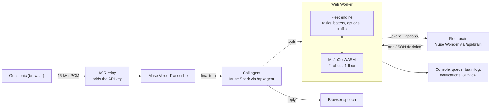

# Muse Concierge

A hotel guest phones room service. A Muse Spark agent takes the order, reads the room number back, quotes an ETA and hangs up. A Muse Wonder "fleet brain" decides which of two delivery robots takes the job. When a robot breaks down halfway down the corridor, the brain re-plans the delivery. The robots are simulated in MuJoCo in the browser.

Built for the **Meta Global AI Developer Hackathon** (indie track, Push the Frontier). **Everything in this repository was built during the hackathon** (Oct 26 – Nov 4, 2026). The commit history is the record.

## What the demo shows

1. **Housekeeping is already running.** Robot 2 is out on a housekeeping drop to room 806.
2. **A guest calls.** "Two towels to room 804, please." Muse Voice Transcribe hears it. The Spark agent confirms the room, creates the task and gives an ETA.
3. **The brain assigns robot 1.** Muse Wonder gets the new-order event and picks robot 1, the only idle robot.
4. **Robot 1 has a battery fault mid-corridor**, dropping to 9%. The engine works out every option with its ETA:
   - carry on: not feasible, it needs 16% and has 9%;
   - charge first: about 11 minutes;
   - hand off to robot 2 by pausing housekeeping: about 45 seconds.
5. **The brain hands the order to robot 2.** Robot 1 limps home to charge, and robot 2 drops housekeeping, loads the towels and delivers.
6. **Housekeeping resumes.** When robot 2 is free again, the brain puts it back on the paused housekeeping task.

The console shows all of it live:
- the call transcript;
- the task queue (the row flips to *reassigned*);
- the brain log, in plain language, with Wonder's latency;
- the room notifications (*On the way*, *Delayed*, *Arrived*);
- battery bars;
- the 3D floor with follow cameras.

## Meta models and what each one does

| Job | Model | Notes |
|---|---|---|
| Hearing the guest | **Muse Voice Transcribe** (`muse-voice-transcribe-1.0`) | Streaming, endpointing, keyword biasing on `room 801`…`806` and item names |
| Talking to the guest, calling tools | **Muse Spark** (`muse-spark-1.1`) | `create_task`, `get_task_status`, `cancel_task`, `end_call`. One agent per call |
| Running the fleet | **Muse Wonder** (`muse-wonder-1.0`) | Called only on events. Picks one engine-computed option and answers in JSON |

These parts are not Meta models:
- **Speech output:** the browser's own speech synthesis. Muse Voice Transcribe is speech-to-text only.
- **Physics:** MuJoCo.
- **Backup transcriber:** AssemblyAI, behind `ASR_PROVIDER`, used only if the Muse relay can't be reached.

### Measured, not assumed

Each choice below came from a script in `scripts/`. You can re-run any of them.

**Transcription** (`scripts/asr-bench.mts`): 10 hotel requests in five English accents, streamed in real time.

| Provider | Room numbers right | Median delay after speech ends |
|---|---|---|
| Muse Voice Transcribe, phrase keywords | 9/10 | 538 ms |
| AssemblyAI Universal-Streaming | 10/10 | 1648 ms |

- Biasing on whole phrases ("room 805") instead of bare numbers took Muse from 7/10 to 9/10, because it stops hearing "room eight…" as "roommate".
- To cover the remaining error, the agent always reads the room back, and `create_task` rejects rooms that don't exist.

**Call agent** (`scripts/agent-ablation.mts`). Spark always reasons before answering; no setting turns that off. So the script compares model version, effort level and a "decide fast" prompt nudge on the four turns of a call:

| Setting | Median latency per turn |
|---|---|
| Spark 1.3 | 1.7–1.8 s |
| **Spark 1.1, minimal effort + nudge** (shipped) | **about 0.9 s** |

Every setting got every turn right, so speed decided.

**Brain** (`scripts/brain-check.mts`): at minimal effort, Wonder chose correctly every time, in 1.7–7 s.

## How it fits together



- **The physics never shares a thread with the voice call.** MuJoCo and the task engine run in a Web Worker, and the page talks to them through `FleetClient`.
- **Tools return immediately.** `create_task` queues the order and returns an ETA. Arrival comes back later as an event, never as a tool result.
- **The brain chooses, it never invents.** The engine offers the options with ETAs it computed. `parseDecision` accepts only an offered option, and the engine checks again before applying it. If the reply is slow, malformed or stale, the fastest feasible option is applied instead, and the log marks it *fallback*.
- **People never read model-written text in the console.** The brain log lines and room notifications are built from the brain's JSON.
- **Two traffic rules:**
  - one robot at a time at the pickup, closer robot first;
  - stop for a robot within 0.8 m ahead, with robot 1 having right of way.

  Robots also keep to the right-hand lane of the corridor.

## Running it

You need Node 24 and Chrome, and keys for the Meta Model API and Supabase (AssemblyAI is optional).

```bash
npm install
cp .env.example .env          # fill in the keys
npm run relay                 # terminal 1: Muse Voice Transcribe relay on ws://localhost:8787
npm run dev                   # terminal 2: http://localhost:3000
```

- **Demo mode:** open **http://localhost:3000/?demo=1** to have the battery fault fire automatically on robot 1's first delivery. Without it, use the **Battery fault: robot 1** button.
- **Database:**
  - **Reused:** the item list comes from the `inventory_items` table of the author's earlier Concierge project. That's the one piece of pre-existing infrastructure this project uses.
  - **New (for the hosted site only):** saved runs and the per-IP call limit. They need `supabase/migrations/20261030120000_muse_fleet_state.sql` applied. Without it, local development still works: the run just isn't saved, and limits only apply in production.
- **Why a relay:** Muse Voice Transcribe takes the API key inside the WebSocket and has no short-lived browser token. `scripts/asr-relay.mjs` adds the key on the server. It only accepts the origins in `ASR_RELAY_ORIGINS` and caps each session at 5 minutes. For a hosted deployment, run it behind a TLS proxy or tunnel and set `NEXT_PUBLIC_ASR_RELAY_URL=wss://…`.

## Checks

```bash
npm test                                    # 52 unit tests: tools, engine, options, brain, notifications, metrics
node scripts/sim-check.mts                  # the full battery-fault scenario on real MuJoCo physics, headless
node scripts/call-check.mts                 # a scripted call through /api/agent (dev server running)
node --env-file=.env scripts/brain-check.mts
node scripts/relay-check.mjs [relay-url]    # stream a bench clip through the ASR relay, print what Muse heard
```

## Limits and what is not here

- **Robots:** two robots on one floor, driven by a waypoint graph with pure pursuit. There is no SLAM and no lift.
- **Speech output** uses the browser's voices.
- **SAM 3.1 door check:** tried and dropped. SAM found nothing in the flat-shaded simulator frames, even for "door" or "robot". A real door check needs photographic textures or real camera frames.
- **Spend limits:** the hosted demo allows 3 calls per IP per day.

## Repository layout

```
app/                 console page and API routes (agent, brain, call start, inventory, fleet state, ASR token)
components/          call panel, 3D view, robot cards, task queue, brain log, notifications, metrics
lib/agent/           call-agent tools, prompt, session
lib/brain/           brain prompt, decision parsing and fallback, log lines, page-side client
lib/fleet/           engine, options and ETAs, navigation, notifications, metrics (+ tests)
lib/sim/             MuJoCo SimPort, Web Worker, client, message types
lib/voice/           mic capture, Muse and AssemblyAI adapters, echo gate, speech
public/sim/floor.xml the hotel floor and both robots (MJCF)
scripts/             benches, checks, ASR relay
```
